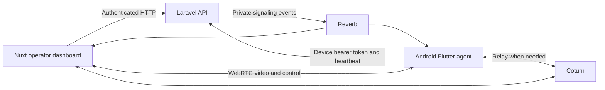

# Remote access architecture and review

Reviewed 27 September 2026. This describes the current working files, including existing uncommitted Flutter changes. No application code, credentials, deployments, or device settings were changed during this review.

## Scope and components

| Component | Responsibility |
| --- | --- |
| `remote_access` | Flutter agent installed on Android kiosks; stores enrollment, maintains signaling and heartbeats, captures video, executes allowed input. |
| `charity-laravel-api` | Device identity, enrollment codes, Sanctum device credentials, operator authorization, session lifecycle, signaling endpoints, and temporary TURN credentials. |
| Laravel Reverb | Delivers private device and session events over WebSockets. It carries connection negotiation and lifecycle messages. |
| `nuxt-dashboard` | Operator interface, enrollment management, WebRTC answerer, video display, and input controls. |
| `charity-turn` | Coturn relay used when a direct WebRTC path cannot be established, including kiosks behind mobile carrier NAT. |
| Scalefusion | Existing device inventory and management integration. The dashboard resolves its kiosk ID to the local Laravel device record. Reboot/lock and similar Scalefusion actions are separate from this custom WebRTC session. |

The marketing API, charity login application, and separate dashboard UI project are outside this review except for the existing shared context. The custom remote-control path is implemented in the four primary projects above.

Laravel/Reverb coordinate the connection. Screen video and input use WebRTC, directly or through Coturn. The inspected implementation does not record the screen on the Laravel server.

## Device enrollment and provisioning

1. An operator with `dashboard.devices.remote-control` opens the device page. `RemoteScreen.client.vue` resolves its kiosk ID using `GET /api/remote/devices/by-kiosk/{kioskId}`. The response identifies the local Laravel `devices.id` and reports enrollment and presence.
2. The dashboard calls `POST /api/devices/{device}/remote/enrollment-code`. The API removes older unused codes and creates `RMT-{deviceId}-{random}`, valid for ten minutes.
3. A technician installs the agent and enters that code. The public, throttled `POST /api/device/enroll` endpoint exchanges it for a Sanctum token belonging to the `Devices` model. Existing device tokens are deleted. The response also contains the device ID, Reverb application key, and private device channel name.
4. Flutter saves the credential and connection metadata using `flutter_secure_storage`. On the next app launch, `bootstrap()` loads this enrollment and reconnects without another code.
5. Android permissions require separate provisioning. The script grants `PROJECT_MEDIA`, enables the accessibility service, grants notifications where supported, and requests battery exemption. The app deliberately targets SDK 33 for the documented unattended capture approach; its minimum Android SDK is 30.

Enrollment links the app to the device record selected by the code. The code is the pairing credential: this path does not independently verify that the physical device has the matching Scalefusion ID, serial, or hardware identity. Entering a valid code on another device pairs that installation to the selected record.

Generating a new code does not immediately disconnect the current installation. Redeeming the new code rotates its token. Dashboard revocation removes tokens and unused codes, clears presence, ends open sessions, and sends a revocation event. The agent also treats authenticated HTTP 401 responses as revocation and clears its local credential.

## Presence and sessions

- The agent sends a heartbeat every 30 seconds, including accessibility state, app/OS version, and its current `active_session_id` or null.
- Laravel considers a device online when its last heartbeat is less than 90 seconds old. This measures API reachability; it does not verify a successful Reverb channel subscription or functioning capture.
- Starting a session checks authorization, enrollment, recent presence, and whether another session is open. A device-row lock and PostgreSQL partial unique index enforce one non-ended session per device.
- The API creates a `requested` session, generates an ICE server list, and broadcasts `session.requested` to `private-device.{id}`. The browser receives the session ID and the same ICE server list in the HTTP response.
- The device subscribes to `private-remote-session.{id}`, starts its screen-capture foreground service, acquires MediaProjection through `flutter_webrtc`, creates the `control` data channel, and posts the SDP offer.
- Laravel marks the session `active` when the device posts its offer. This database status means negotiation has begun; the browser separately waits for WebRTC `connected` before displaying its active status.
- The browser applies the offer, posts an answer, and both peers exchange ICE candidates through Laravel/Reverb.
- Video travels from the device to the browser. Input travels over the data channel as normalized taps, long presses, swipes, navigation keys, or text. Kotlin's `RemoteInputService` executes it through Android accessibility APIs. Input is implemented, despite several comments still saying it is a future phase.
- Ending a session records its reason and broadcasts to both the device and session channels. The agent releases the data channel, media stream, peer connection, and foreground capture service.

| Timing | Current value |
| --- | --- |
| Enrollment code lifetime | 10 minutes |
| Device heartbeat | 30 seconds |
| Online window | 90 seconds |
| Device HTTP requests | 15-second timeout |
| Capture acquisition | 30-second timeout |
| Agent WebRTC negotiation | 45 seconds after posting the offer |
| Browser connection window | 45 seconds after receiving session creation |
| Requested/active stale-session threshold | 120 seconds |
| Scheduled stale-session sweep | Every minute |
| Default TURN credential lifetime | 3,600 seconds |

## Findings

P1 findings should be addressed before relying on the feature across an unattended fleet. P2 findings affect normal operation and should follow. Reproduction results below distinguish controlled simulations from physical-device testing.

### 1. P1 — Enrollment redemption can race another redemption or revocation

**Evidence:** [DeviceEnrollmentController.php](<//wsl.localhost/Ubuntu/home/abdallah644/projects/my-projects/charity/charity-laravel-api/src/app/Http/Controllers/DeviceEnrollmentController.php:32>), lines 32–65; `RemoteDeviceController.php`, lines 78–92.

The unused/unexpired code is loaded before the transaction, without a lock. The transaction then saves that already-loaded model and issues a token without rechecking the code or acquiring the device lock used by revocation.

Two requests can both pass the one-time-code check. More seriously, a request that loaded the code just before revocation can continue afterward and recreate a valid device token, undoing the administrator's revoke.

**Reproduced:** Temporary SQLite tests interleaved controller calls at the enrollment-model retrieval event. Two overlapping redemptions both returned HTTP 201 with different credentials. A second test revoked after lookup but before redemption; redemption still returned 201 and recreated a device token. These exercise the stale model behavior, not real parallel PostgreSQL connections.

**Fix direction:** Redeem and validate the code inside the same transaction as token rotation, using a consistent device/code lock order shared by revoke and code generation. Recheck code existence, expiry, and redemption after acquiring locks. Add concurrent PostgreSQL coverage as well as sequential replay tests.

### 2. P1 — A lost session-end event can leave remote access running

**Evidence:** [RemoteSessionLifecycle.php](<//wsl.localhost/Ubuntu/home/abdallah644/projects/my-projects/charity/charity-laravel-api/src/app/Services/RemoteSessionLifecycle.php:187>), lines 187–213; `DeviceEnrollmentController.php`, lines 97–121; [device_daemon.dart](C:/src/projects/remote_access/lib/src/services/device_daemon.dart:156).

The API commits `ended` even if broadcasting fails. Subsequent heartbeats from an agent still serving that ended session return an empty successful response. They do not instruct the agent to stop, and reconnecting signaling does not reconcile session state. A still-connected WebRTC pair can therefore continue after another operator force-ends it or after the server reaps it during an API interruption.

This is distinct from token revocation: revocation does have a 401 fallback when the API is reachable. A normal/forced session end leaves the device token valid.

**Reproduced:** A temporary test ended the session without event delivery, then sent a heartbeat naming it. The API returned empty HTTP 204 while the database session remained ended. Continued media is inferred from the agent's lack of a reconciliation or lease-expiry path; it was not tested on hardware.

**Fix direction:** Return authoritative session state or a short renewable session lease in heartbeats. Stop capture/input when the session is ended, mismatched, or the lease expires, and reconcile after reconnect. A database transition alone cannot terminate an established peer connection.

### 3. P1 — The initial WebRTC offer can arrive before the browser subscribes

**Evidence:** [RemoteSessionController.php](<//wsl.localhost/Ubuntu/home/abdallah644/projects/my-projects/charity/charity-laravel-api/src/app/Http/Controllers/RemoteSessionController.php:99>), lines 99–122; [useRemoteSession.ts](<//wsl.localhost/Ubuntu/home/abdallah644/projects/my-projects/charity/nuxt-dashboard/nuxt-app/app/composables/useRemoteSession.ts:201>), lines 201–253.

The API immediately tells the device to start before returning the session ID to the browser. Only after the response does the browser request its private subscription. A fast, pre-provisioned device can publish the offer before browser channel authorization completes. The implementation neither persists/replays the offer nor waits for a browser-ready acknowledgment.

The agent also starts work immediately after requesting its own session subscription, without waiting for subscription success.

**Reproduced:** An in-memory harness executed the actual dashboard composable with mocked transport. Publishing the device offer before the start response resulted in no offer handler, no answer, and a browser left in `connecting`.

**Fix direction:** Create the session, confirm both peers' subscription readiness, then start negotiation; alternatively provide durable, idempotent offer/answer retrieval and replay. Arbitrary delays will not guarantee readiness.

### 4. P1 — Unattended startup and recovery are not implemented in the agent

**Evidence:** [main.dart](C:/src/projects/remote_access/lib/main.dart:9), [AndroidManifest.xml](C:/src/projects/remote_access/android/app/src/main/AndroidManifest.xml:9), and [provisioning/README.md](C:/src/projects/remote_access/provisioning/README.md:74).

The daemon starts from Flutter's application entry point. The manifest declares boot permission but no boot receiver that starts the agent. The accessibility service does not initialize a Flutter engine or signaling daemon; the capture service runs only for sessions and returns `START_NOT_STICKY`.

The provisioning README explicitly marks auto-start and continued background connectivity as future work. Persisting credentials and granting battery exemption do not themselves implement restart recovery.

**Impact:** The installation can remain enrolled while unreachable after reboot or process termination until something launches the app. An external MDM policy could supply launch/recovery behavior, but that policy was not inspected or verified here.

**Fix direction:** Define the agent's lifecycle and recovery mechanism together with the actual fleet's Android/MDM constraints, then test cold boot, task dismissal, process death, app update, and a long idle period with the donation app in front.

### 5. P2 — Early device ICE candidates are discarded in the dashboard

**Evidence:** [useRemoteSession.ts](<//wsl.localhost/Ubuntu/home/abdallah644/projects/my-projects/charity/nuxt-dashboard/nuxt-app/app/composables/useRemoteSession.ts:312>), lines 312–320; `remote_session.dart`, lines 130–142 and 239–251.

The device can post ICE while posting its offer. The browser immediately calls `addIceCandidate()` and swallows any rejection. If a candidate arrives before the remote description, it is lost rather than buffered. The Flutter side already buffers candidates until the answer is applied; the browser needs equivalent handling.

The [W3C WebRTC specification](https://www.w3.org/TR/webrtc/#dom-rtcpeerconnection-addicecandidate) requires rejection when the remote description is null.

**Reproduced:** The dashboard harness delivered ICE before the offer. One candidate was attempted, zero were accepted, and it was never replayed after setting the description.

**Fix direction:** Queue candidates until the remote description is installed, flush in order, and clear the queue on session teardown. Also address pre-subscription event loss from finding 3.

### 6. P2 — Pointer coordinates include black margins around the video

**Evidence:** [RemoteScreen.client.vue](<//wsl.localhost/Ubuntu/home/abdallah644/projects/my-projects/charity/nuxt-dashboard/nuxt-app/app/components/RemoteScreen.client.vue:209>), lines 209–217 and 579–584.

The video uses full width, a `70vh` height cap, and `object-fit: contain`. Pointer normalization divides by the whole video element rather than the actual rendered image rectangle. When a portrait kiosk image is letterboxed in a wide panel, its left edge can map far inside the kiosk screen. Clicks on the black margins can also dispatch input.

For example, a 1080×1920 stream inside a 900×560 element renders 315 pixels wide, centered at x=292.5. A click at that image's left edge is sent as x=0.325 instead of x=0.

**Verification:** Source and geometry analysis; no rendered browser/physical-device test performed.

**Fix direction:** Calculate the contained image rectangle from `videoWidth`, `videoHeight`, element dimensions, and object positioning. Reject clicks outside it and normalize coordinates within it. Verify portrait, landscape, resize, and rotation.

### 7. P2 — Failed enrollment takes the technician away from the code form

**Evidence:** [device_daemon.dart](C:/src/projects/remote_access/lib/src/services/device_daemon.dart:58), lines 58–90; [main.dart](C:/src/projects/remote_access/lib/main.dart:30).

Submitting a code changes the phase to `connecting`, which selects the dashboard screen. An invalid/expired code or failed API request sets the phase to `error`; the app still selects the dashboard because only `notEnrolled` displays the enrollment form. The technician cannot simply correct the code and retry without resetting through the unenroll flow.

**Verification:** Source trace; the existing widget test only checks the standalone form's initial rendering.

**Fix direction:** Separate credential/enrollment state from connection state. Keep failed, unpaired enrollment on the code form with the error and retry action.

### 8. P2 — Local unenrollment forgets the credential without revoking it

**Evidence:** [device_daemon.dart](C:/src/projects/remote_access/lib/src/services/device_daemon.dart:376), lines 376–405, and `dashboard_screen.dart`'s unenrollment confirmation.

The device's Unenrol action ends its session and deletes local storage but never deletes the server token. The dashboard continues to report it as enrolled because that is based on token existence. A copied credential also remains valid, despite the confirmation describing the operation as revocation.

**Fix direction:** Add an authenticated device self-revocation endpoint and call it during unenrollment, with clear handling if the device is offline. Local forgetting and successful server revocation need distinct outcomes.

## Readiness and deployment checks

- `projection_ready` is hard-coded to true in the agent. It does not check the app-op or capture outcome. Accessibility reporting checks the enabled-settings list rather than whether the service instance is currently connected. Treat these as incomplete capability signals.
- Several phase comments and setup sections say native input is pending, but the Kotlin implementation exists. Update these when documenting the actual rollout state.
- Coturn uses temporary HMAC credentials, private-range relay restrictions, quotas, an unprivileged container, and redacted generated configuration. No obvious mismatch was found in the credential algorithm; its tests pass.
- The committed production TURN deployment instructions initially use UDP/TCP port 3478 and defer TLS configuration. The code supports TLS with mounted certificates, but this review did not inspect the production configuration, firewall, DNS, or actual relay connectivity. Verify sessions across different networks and with UDP blocked; gathering a relay candidate alone is weaker evidence than a complete relayed video/control session.
- The unattended MediaProjection approach depends on the target SDK, the provisioned app-op, and each device's Android implementation. Confirm it on the actual fleet models. Android documents session-consent and capture-stop requirements in its [MediaProjection guide](https://developer.android.com/media/grow/media-projection); permission changes or target SDK upgrades require device testing.

## Verification and limits

| Check | Result |
| --- | --- |
| Existing enrollment, remote session, channel authorization, and TURN PHPUnit tests | 47 passed, 245 assertions |
| Temporary enrollment/heartbeat reproduction tests | 3 passed, 9 assertions confirming the behaviors described above |
| Actual dashboard composable with mocked HTTP, signaling, and WebRTC | Offer-before-subscription and ICE-before-offer loss reproduced |
| `flutter analyze --no-pub` | No issues found |
| `flutter test --no-pub` | Existing enrollment-form widget test passed |

Backend tests ran in the existing local PHP 8.3 container against an explicitly selected SQLite in-memory database. Temporary PHP tests were removed afterward. No production API requests, remote-control sessions, token changes, or TURN restarts were performed. The review did not exercise PostgreSQL concurrency, browser rendering, live Android capture/input, production permissions, or production network conditions.

Suggested implementation order: atomic enrollment/revocation; authoritative session-stop reconciliation; subscription readiness and ICE buffering; unattended lifecycle; input geometry; enrollment/unenrollment UX and accurate capability reporting. Add focused regression tests around these behaviors, then validate the complete path on representative kiosks.
